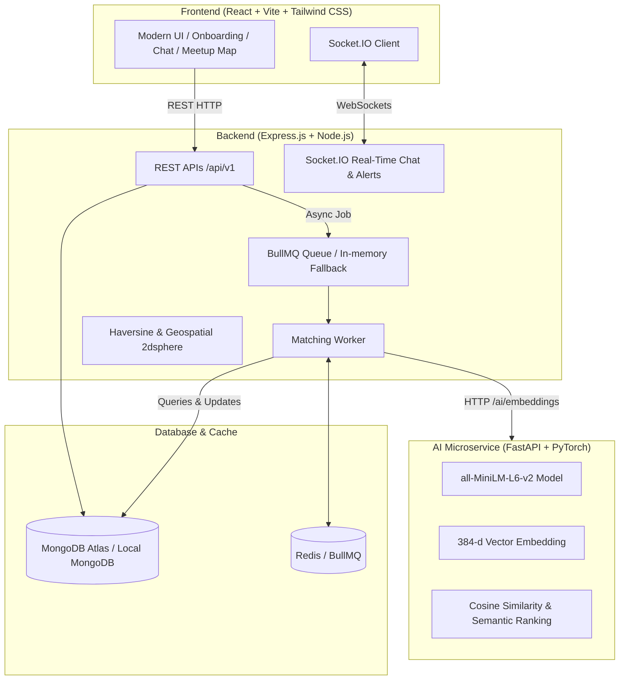

# InterestHub – AI-Powered Automatic Community & Meetup Platform

> *"Find Your People. Share Your Passion. Make Real Connections."*

InterestHub is an autonomous, AI-driven social platform that eliminates the need for users to manually search for communities or like-minded peers. Powered by Sentence Transformers (`all-MiniLM-L6-v2`), geospatial MongoDB queries, and BullMQ background workers, the system automatically analyzes preferences, searches existing communities, and forms new groups whenever compatible individuals register.

---

## 🏗️ System Architecture

InterestHub is structured as a clean monorepo separating concerns across four primary layers:

```
interesthub/
│
├── frontend/             # React.js (ES6+ JSX), Vite, Tailwind CSS, Redux Toolkit, Socket.IO Client, Framer Motion
├── backend/              # Node.js, Express.js, Mongoose, Socket.IO, BullMQ, Redis, JWT
├── ai-service/           # Python, FastAPI, Sentence Transformers (all-MiniLM-L6-v2), Scikit-learn, NumPy
├── infrastructure/       # Docker configurations and deployment scripts
├── docker-compose.yml    # Full-stack containerized composition
└── README.md
```



---

## 🧠 AI Semantic Matching Engine

InterestHub does not use hardcoded or fake match percentages. Every interest profile is encoded into a normalized **384-dimensional vector** via Sentence Transformers (`all-MiniLM-L6-v2`).

### 1. Weighted Matching Score Formula

$$\text{Overall Score} = (\text{Interest Sim} \times 0.50) + (\text{Location Score} \times 0.20) + (\text{Activity Score} \times 0.15) + (\text{Preference Score} \times 0.15)$$

- **Interest Similarity (50%)**: Cosine similarity between 384-dimensional semantic embedding vectors.
- **Location Compatibility (20%)**: Haversine distance within a 10 km default local matching radius (100% for online communities).
- **Activity Compatibility (15%)**: Jaccard similarity across selected activity types (Indoor, Outdoor, Weekend, Learning, etc.).
- **Preference Compatibility (15%)**: Alignment on environment and online/offline participation.
- **Threshold**: 70% minimum score for compatibility.

### 2. Autonomous Group Formation Rules

- **Min Accepted Members**: 3. Only accepted members count towards activation.
- **Group Status**: Starts in `FORMING`. Becomes `ACTIVE` when at least 3 members accept.
- **Capacity**: Maximum 10 reserved members (accepted members + pending invitations $\le 10$).
- **Priority**: Existing suitable communities are always searched first to prevent duplicates.
- **Pending Pool**: Users with fewer than 2 other compatible peers remain in `PendingMatch` until more compatible users register.

---

## 🚀 Quick Start & Local Execution

### Prerequisites

- **Node.js**: v18+ (tested on v24)
- **Python**: v3.10+ (tested on v3.12)
- **MongoDB**: Local MongoDB on port 27017 or MongoDB Atlas connection string
- **Redis** *(Optional)*: Local Redis on port 6379 (automatically falls back to in-memory async processing if Redis is unavailable)

---

### Step 1: Clone and Configure Environment

```bash
git clone <repository_url>
cd interestHub
cp .env.example .env
```

---

### Step 2: Start the Python AI Microservice

```bash
cd ai-service

# Create virtual environment
python -m venv venv
venv\Scripts\activate  # Windows
# or: source venv/bin/activate  # Linux/macOS

# Install dependencies
pip install -r requirements.txt

# Start FastAPI microservice
uvicorn app.main:app --host 127.0.0.1 --port 8000
```
*Health check:* [http://127.0.0.1:8000/health](http://127.0.0.1:8000/health)

---

### Step 3: Start the Backend Service

In a new terminal:
```bash
cd backend
npm install
npm run dev
```
*API Base:* [http://localhost:8080/api/v1](http://localhost:8080/api/v1)

---

### Step 4: Start the Frontend Application

In a new terminal:
```bash
cd frontend
npm install
npm run dev
```
*App URL:* [http://localhost:5173](http://localhost:5173)

---

## 🧪 Automated Testing

### 1. Backend Lifecycle & Matching Tests (Jest)

Executes Test Cases 1 through 5 from the Master Specification:
- Automatic group creation when 3 compatible users register (Rahul, Aman, Priya)
- Existing group matching for a 4th user (Vikram) without duplicate groups
- Pending matching pool retention when only 2 users are present
- Group capacity enforcement (10 reserved seats)
- Invitation rejection and seat release

```bash
cd backend
npx jest tests/matching.test.js --forceExit
```

### 2. Python AI Service Tests (PyTest)

Verifies cosine similarity, Sentence Transformer embeddings, and semantic matching on similar text ("I enjoy travelling" vs "I love hiking"):

```bash
cd ai-service
venv\Scripts\python -m pytest -v tests/test_ai_service.py
```

### 3. Full End-to-End Live Workflow Verification

Tests the complete live lifecycle against the running backend server:
```bash
cd backend
node tests/e2e_verification.js
```

---

## 📡 Core API Endpoints

| Method | Endpoint | Description |
|---|---|---|
| `POST` | `/api/v1/auth/register` | Register new user account |
| `POST` | `/api/v1/auth/login` | Authenticate user & issue JWT |
| `GET` | `/api/v1/auth/me` | Fetch current user session |
| `PUT` | `/api/v1/users/profile` | Update bio, age range, preferences |
| `PUT` | `/api/v1/users/interests` | Update passions & trigger AI matching |
| `PUT` | `/api/v1/users/location` | Update city, coordinates & radius |
| `GET` | `/api/v1/groups` | Discover communities with filters |
| `GET` | `/api/v1/groups/my` | Retrieve joined active/forming communities |
| `GET` | `/api/v1/groups/recommended` | Retrieve AI recommended communities |
| `GET` | `/api/v1/groups/:id` | Fetch community details & members |
| `GET` | `/api/v1/invitations` | List pending invitations with match % |
| `POST` | `/api/v1/invitations/:id/accept` | Accept invite (activates group if $\ge 3$) |
| `POST` | `/api/v1/invitations/:id/reject` | Decline invite & release seat |
| `GET` | `/api/v1/groups/:id/messages` | Message history for verified members |
| `POST` | `/api/v1/groups/:id/messages` | Post message to group room |
| `GET` | `/api/v1/activities/nearby` | Fetch nearby meetups for OpenStreetMap |
| `POST` | `/api/v1/activities/group/:id` | Plan a new group meetup |
| `POST` | `/api/v1/activities/:id/join` | Join planned meetup activity |

---

## 🐳 Docker Deployment

To spin up all services (MongoDB, Redis, Python AI Service, Node.js Backend, Nginx Frontend) with a single command:

```bash
docker-compose up --build
```

Access the application at `http://localhost:5173`.
